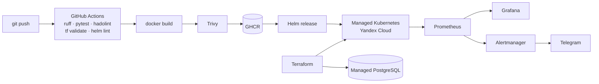

# infra-lab

[](https://github.com/Sakuratix/infra-lab/actions/workflows/ci.yml)

Путь небольшого веб-сервиса от кода до продакшена в одном репозитории: контейнер, CI с проверками и сканированием, Helm-чарт для Kubernetes, инфраструктура Yandex Cloud на Terraform, базовая настройка серверов Ansible и мониторинг на Prometheus + Grafana.



## Что внутри

| Каталог | Что там |
| --- | --- |
| `app/` | HTTP-сервис на стандартной библиотеке Python: `/healthz`, `/readyz`, `/metrics` в формате Prometheus, graceful shutdown по SIGTERM. Многоступенчатый Dockerfile: тесты гоняются на этапе сборки, финальный образ запускается не от root. |
| `helm/app/` | Чарт: RollingUpdate без простоя, readiness/liveness-пробы, `preStop` для дренажа, HPA, PDB, Ingress с cert-manager, опциональный `ServiceMonitor`, securityContext (read-only FS, drop ALL). |
| `terraform/` | VPC и подсеть, сервисный аккаунт с минимальными ролями, Managed Kubernetes (STABLE, окно обслуживания), группа узлов (прерываемые вне prod), Managed PostgreSQL 16. Пример remote state в Object Storage. |
| `ansible/` | Роль `hardening` (sshd без паролей и root, ufw, fail2ban, unattended-upgrades) и роль `node_exporter` с systemd-юнитом. |
| `monitoring/` | Prometheus с алертами (сервис недоступен, доля 5xx, p95), Alertmanager с заготовкой Telegram, Grafana с дашбордом по RED-метрикам. |
| `.github/workflows/` | Линтеры, тесты, валидация IaC, сборка с кэшем, Trivy, пуш в GHCR только из `main`. |

## Быстрый старт

```bash
# локальный стенд: сервис + Prometheus + Alertmanager + Grafana
docker compose up -d --build
curl localhost:8080/metrics
open http://localhost:3000   # дашборд infra-lab · RED

# тесты и линт
make test lint
```

## Деплой в Kubernetes

```bash
cd terraform
cp terraform.tfvars.example terraform.tfvars   # cloud_id / folder_id
export YC_TOKEN=$(yc iam create-token) TF_VAR_db_password='...'
terraform init && terraform apply
$(terraform output -raw kubeconfig_command)

helm upgrade --install demo ../helm/app \
  --set image.tag=<git-sha> \
  --set ingress.enabled=true --set ingress.host=demo.example.com
```

## Решения

- **Тесты внутри Dockerfile.** Образ, который не прошёл тесты, просто не собирается — так не нужно доверять, что CI запустил их отдельно.
- **`readyz` ≠ `healthz`.** На SIGTERM сервис сначала перестаёт быть ready, и Kubernetes убирает его из Endpoints, а `preStop: sleep 5` даёт ingress-контроллеру время это заметить.
- **Секреты не в git.** Пароль БД идёт через `TF_VAR_db_password`, токен Telegram — через `bot_token_file`, в pre-commit стоит gitleaks.
- **Прерываемые узлы вне prod** — dev-кластер обходится в разы дешевле.

## Лицензия

MIT
